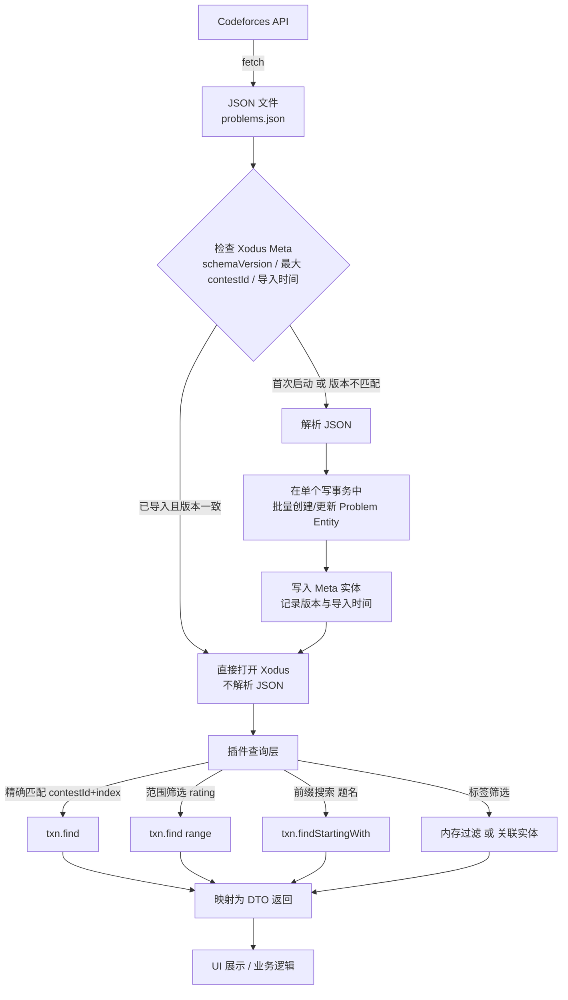

# CFootprint

<p align="center">
  <a href="README.md"></a>
  <a href="README_zh.md"></a>
</p>

一个用于跟踪 Codeforces 刷题进度的 IntelliJ IDEA 插件。以矩阵视图展示题库，按比赛分行、按题号分列，直观呈现每道题的通过状态与难度。

## 功能

- **矩阵视图**：行 = 比赛（Contest），列 = 题号（A、B、C…）。同一题号下的子题（C1、C2）在格子内堆叠显示。
- **分页浏览**：每页显示固定数量的比赛，支持切换每页数量、上一页/下一页、指定页码跳转。
- **状态着色**：背景色表示提交状态——绿色为已通过（AC），黄色为尝试过但未通过，默认色为未做。
- **难度着色**：可选开关，开启后字体颜色按 Codeforces 官方 Rating 等级着色（灰 / 绿 / 青 / 蓝 / 紫 / 橙 / 红 / 深红）。
- **多维度筛选**：按题目名、Rating 范围、题目类型、标签、比赛 Div 分类筛选。
- **题目跳转**：点击题目直接打开浏览器跳转到 Codeforces 对应页面。
- **本地缓存**：题库与比赛数据 6 小时内不重复拉取；用户提交记录支持增量更新，避免频繁请求 API。

## 存储

使用 [Xodus](https://github.com/JetBrains/xodus) 作为嵌入式数据库，无需独立服务。

| 实体 | 说明 |
|---|---|
| `Contest` | 比赛元数据（contestId、name、division） |
| `Problem` | 题目元数据（contestId、index、name、type、points、rating） |
| `ProblemStatistics` | 题目通过人数 |
| `UserProblemStatus` | 按 handle 隔离的用户提交状态（handle、contestId、index、verdict） |

用户状态按 handle 独立存储，切换账号不会互相覆盖。

### 缓存策略

- **题库 / 比赛列表**：启动时检查时间戳，距上次拉取不足 6 小时则跳过网络请求，直接读本地数据库。
- **用户提交记录**：首次加载全量，之后同一 handle 在 6 小时内重复加载只解析本地 JSON，不重复请求 API。
- 增量合并规则：本地已 AC 的题目不会被后续非 AC 提交降级。

## 使用

1. 在 IDEA 右侧工具栏打开 **CFootprint** 工具窗口。
2. 在顶部输入 Codeforces handle，点击 **加载**。
3. 首次加载会拉取提交记录并写入本地数据库，之后打开 IDE 会自动恢复上次的 handle 与状态。
4. 使用筛选条按题目名、Rating、类型、标签、Div 分类过滤。
5. 点击任意题目打开 Codeforces 页面。

### 设置

- **按难度着色**：工具栏复选框控制字体是否按 Rating 等级着色。
- **字体**：在 `Settings → Tools → CFootprint` 中调整字体族与字号偏移。

## 构建

```bash
./gradlew buildPlugin
```

产物位于 build/distributions/。

## 技术栈
- IntelliJ Platform SDK

- Xodus（嵌入式数据库）

- Fastjson2（JSON 解析）

- Swing / JetBrains UI 组件

## 说明
- 插件遵循 Codeforces API 的频率限制，题库与用户数据均有本地缓存，不会对服务器造成额外负担。

- 用户提交状态按 handle 隔离存储，支持多账号切换。

- 题库数据来源于 Codeforces 公开 API，题目内容版权归 Codeforces 所有。


